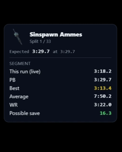

# Speedrun Overlay

<p align="center">
  <a href="https://github.com/lukeroddis/speedrun-overlay/actions/workflows/ci.yml"></a>
  <a href="tests/run_tests.py"></a>
  <a href="tests/run_tests.py"></a>
  <a href="https://obsproject.com/"></a>
  <a href="https://github.com/lukeroddis/speedrun-overlay/releases"></a>
  <a href="https://github.com/lukeroddis/speedrun-overlay/issues"></a>
  
</p>

<p align="center">
  
</p>

A modern, minimalist overlay for speedrunners, optimized for OBS Studio Browser Sources (1080p, 1440p, 4K).

Traditional LiveSplit layouts consume substantial vertical screen space over modern 16:9 gameplay. This overlay delivers a sleek, non-intrusive progress timeline with fully repositionable HUD components, dual timers, ghost runners, live therun.gg race standings with racer pins, and per-game layout profiles.

---

## 📋 Prerequisites & Compatibility

| Software | Minimum Version | Recommended | Notes |
| :--- | :--- | :--- | :--- |
| **LiveSplit** | **v1.8.30+** (or v1.7.0+ with legacy `LiveSplit.Server.dll`) | **v1.8.37+** | Built-in WebSocket server under `Control → Start WebSocket Server` (zero external DLLs required). |
| **OBS Studio** | **v27.2+** | **v29.0+** (or 30+) | Supports modern Chromium browser sources, hardware acceleration, and CSS `backdrop-filter` frosted glass blur. |
| **Desktop Browsers** | Chrome 90+, Edge 90+, Firefox 90+ | Latest | For standalone browser display and multi-monitor setups. |

---

## ⚡ Quick Start (60 Seconds)

1. **Start LiveSplit WebSocket Server**:
   * **LiveSplit v1.8.30+ (Recommended)**: Right-click LiveSplit → **Control** → **Start WebSocket Server** (default: `ws://localhost:16834/livesplit`).
     * *Tip (v1.8.37+)*: In `Right-click → Settings`, check the option to automatically start the WebSocket server whenever LiveSplit opens.
   * **Older LiveSplit versions (v1.7.0 – v1.8.29)**: Right-click → **Edit Layout** → add **Control → LiveSplit Server**, then right-click → **Control → Start Server**.
   * *(Important: Select **WebSocket Server**, not TCP Server, as browser overlays communicate via WebSockets).*
2. **Open the Overlay**:
   * Download the latest `speedrun-overlay-v*.html` from [Releases](https://github.com/lukeroddis/speedrun-overlay/releases). The release is one fully self-contained HTML file; no server or companion files are required.
   * **In OBS Studio (Recommended)**: Add a **Browser Source**, **untick *Local file*** and put a `file:///` URL to the downloaded HTML file in the **URL** field (e.g. `file:///C:/Overlays/speedrun-overlay-v2.1.0.html`). Set the resolution to `1920×1080` (or match your canvas resolution), and check *"Shutdown source when not visible"*.
   * **In Desktop Browser**: Open the downloaded HTML file in Chrome, Edge, or Firefox.
3. **Load Your Splits**:
   * Drag and drop your `.lss` splits file directly onto the window. Splits, targets, and history are cached locally.
4. **(Optional) Add the OBS Dock**:
   * Change settings such as the comparison, ghosts, visible splits, layout profile, race code and more from an OBS panel, without opening your scene.
   * Download `speedrun-overlay-dock-v*.html` from [Releases](https://github.com/lukeroddis/speedrun-overlay/releases), then in OBS open **Docks → Custom Browser Docks…** and add it with a `file:///` URL (e.g. `file:///C:/Overlays/speedrun-overlay-dock-v2.1.0.html`). It shows **Overlay linked** within a couple of seconds. See [OBS Dock](#6-obs-dock) for details.

---

## 🎮 Key Features

### 1. Split Progress Track

<p align="center">
  
</p>

* **Horizontal or vertical** auto-centering timeline: a widescreen bottom bar or a classic sidebar.
* **LiveSplit delta colours** for ahead/behind and gaining/losing, gold for best segments, and a red pulse when the current split runs overdue.
* **Readable at any density**: split names tilt to 40° as the track fills up.
* **Two track views**: the **Network Track** (nodes joined by bars) or **Minimalist** (one coloured bar per split, nothing else). Split names, deltas and times can be switched on or off for each view.
* **Split info on hover**: hover any split (in a browser, or in OBS through the browser source's *Interact* window) for its icon, delta or expected segment time, and its segment times this run, in your PB, your gold, on average and in the World Record (when your splits have a World Record comparison), plus the time you could still save on it.

### 2. Ghost Runners

<p align="center">
  
</p>

* Glowing pins race along the track showing where a comparison was at this exact moment: **World Record `🏆`**, **Personal Best `🥈`**, **Best Segments `⭐`** or **Average `📊`**.
* **Edge beacons** (`❮ 🏆 -14.2s`) show the live gap when a ghost is off-screen.
* Adjustable pin length and opacity.

### 3. Live Race Standings & Racer Pins

<p align="center">
  
</p>

* **F1-style timing tower** for [therun.gg](https://therun.gg) races: enter the race code under **Settings → Live Race Telemetry** and click **Connect**.
* Live positions with animated overtakes, gap to leader, current split, pace vs. expected, fastest-segment ribbons (🥇🥈🥉), DNF/finished states, and a pre-race countdown/lobby view.
* **Racers as track pins**: every competitor appears on your progress track alongside your ghosts. Toggle all pins with **Pins: ON/OFF**, or **double-click a racer** in the standings to hide or show just their pin.

### 4. Current Split Card

<p align="center">
  
</p>

* A card for the split you're on: its segment ticks live against your PB, gold, average and WR, and turns red once you're over.
* Each finished split stays up for a moment with a **gold / gained / lost glow** before the next card appears.
* After the run, a **run summary**: final time, New PB, golds and time saved, best and worst segments, and a delta graph of the run. It stays up through LiveSplit's reset until your next run starts.
* Choose which rows it shows and how long splits stay up, or show it on its own with `?view=currentsplit`.

### 5. Layout Editor & Game Profiles

<p align="center">
  
</p>

* Press **`E`** (or **`F2`**) to drag and scale (`40%`–`250%`) any component, or dock the track to the bottom (**`⚓`**).
* Each component has a **`⚙`** for its own settings, opened in a panel beside it so you can see what you change (drag it by its header or resize it from its corner if it is in the way; double-click the header to put it back), and a **`✕`** to hide it (**`👁`** brings it back).
* The toolbar holds HUD-wide controls: visibility, split count, text angle and the shared **plate** opacity and blur.
* **Per-game profiles** load automatically when LiveSplit connects or a `.lss` file is dropped.
* **Import/export** as JSON ([schema/layout-v1.json](schema/layout-v1.json)), or copy/paste via the clipboard inside OBS.

### 6. Dual Timers & Game Logo

<p align="center">
  
</p>

* Show **Game Time**, **Real Time** or **both**; click a timer to make it the primary comparison.
* Upload a PNG, SVG or WebP **game logo** in place of the title text.
* **Frosted-glass plates** with adjustable blur and opacity keep text readable over bright games.

### 7. OBS Dock

<p align="center">
  
</p>

An optional OBS panel (a Custom Browser Dock) for changing key settings mid-stream without interacting with your scene. While the dock has keyboard focus, **`C`** / **`Shift+C`** (or **`]`** / **`[`**) step the comparison and the arrow keys scroll your splits.

1. Download `speedrun-overlay-dock-v*.html` from [Releases](https://github.com/lukeroddis/speedrun-overlay/releases) alongside the overlay.
2. The overlay's **Browser Source** must use a `file:///` URL with *Local file* **unticked** (as in the [Quick Start](#-quick-start-60-seconds)); the dock and overlay can only talk to each other this way.
3. **Docks → Custom Browser Docks…**: add a dock with a `file:///` URL to the dock file, e.g. `file:///C:/Overlays/speedrun-overlay-dock-v2.1.0.html`.
4. The dock shows **Overlay linked** within a couple of seconds, then its Race, Profile, Run, Track, Ghost Pins and Visibility sections. *Overlay not found* almost always means the browser source still has *Local file* ticked.

If your source still has *Local file* ticked, **export your layout first** (Settings → Export (.json)), switch to the URL, then re-import it: the switch changes where OBS stores the overlay's saved data.
     
* *Why a URL instead of Local file?* The overlay works the same either way, but only a `file:///` URL lets the OBS Dock talk to it. Switching later moves where OBS keeps the overlay's saved layouts, so it is easiest to start this way.

If you have more than one overlay browser source (e.g. in different scenes), the dock controls all of them.

---

## 🎛️ OBS Hotkeys & URL Parameters

| Control / Hotkey | Action |
| :--- | :--- |
| **`C`** (or **`NumPad 6`** / **`]`**) | Cycle forward to next comparison time (with HUD toast) |
| **`Shift + C`** (or **`NumPad 4`** / **`[`**) | Cycle backward to previous comparison time (with HUD toast) |
| **`Scroll Wheel`** | Scroll splits left/right (or up/down if sidebar) like LiveSplit |
| **`←` / `→`** (or **`↑` / `↓`**) | Pan splits / browse future and previous splits with keyboard arrow keys (works in continuous and windowed mode with pinned last split) |
| **`E`** or **`F2`** | Toggle Interactive Layout Edit Mode (Drag & Scale) |
| **`Esc`** | Close an open settings panel or dialog, else exit Edit Mode |
| **`Settings`** | Bottom-right discreet pill: drop `.lss` files, **⚙ Title / Timer / Track / Current Split Settings** (open Layout Mode), **👻 Ghost Pins**, **🏁 Live Race Settings** (race code, standings, race pins), layout profiles |

For multi-scene or automated OBS setups, configure sources instantly with query parameters:

| URL Parameter | Description | Example |
| :--- | :--- | :--- |
| `?profile=Name` | Load a saved named layout profile | `index.html?profile=Mario+64` |
| `?view=title\|timers\|track\|currentsplit\|leaderboard` | Show only that widget, for a browser source of its own (your saved layout is left as it is) | `index.html?view=currentsplit` |
| `?hide=a,b` | Hide these widgets in this source only | `index.html?hide=title,leaderboard` |
| `?timer=gametime\|realtime\|both` | Set timer visibility mode | `index.html?timer=gametime` |
| `?orient=horizontal\|vertical` | Set track orientation | `index.html?orient=vertical` |
| `?splits=all\|auto\|<count>` | Configure visible split density | `index.html?splits=12` |
| `?ghost=wr\|pb\|best\|off` | Set live ghost runner target | `index.html?ghost=wr` |
| `?bg=0..95` | Set background plate opacity percentage | `index.html?bg=55` |
| `?logo=path/to/logo.png` | Set custom logo image path | `index.html?logo=logo.png` |

---

## 🛠️ Development

Building from source requires Node.js `^20.19.0` or `>=22.12.0`; the test suite also requires Python 3.11.

```bash
npm ci
npm run dev      # Vite dev server with live reload
npm test         # Python + in-browser test suite
npm run build    # → dist/index.html (single self-contained file)
```

The application source remains classic, dependency-free scripts. `vite.config.mjs` swaps the script tags for a generated module entry (built from the same `index.html` script list) during a build, and `vite-plugin-singlefile` inlines the resulting JS and CSS. The `postbuild` check ([scripts/verify-single-file.mjs](scripts/verify-single-file.mjs)) fails the build if `dist/` contains anything other than `index.html` or if the output references an external asset. The source [index.html](index.html) can still be opened directly for quick debugging, but the supported distribution is the built single file.

For WebSocket architecture details, LiveSplit protocol constraints, algorithm specifications, and layout schema definitions, refer to:

👉 **[Developer Guide (DEVELOPER_GUIDE.md)](DEVELOPER_GUIDE.md)**

---

## 🧪 Testing & Code Stability

The repository includes an automated test suite verifying data parsers, ghost interpolation, DOM consistency, and layout schema compatibility:

```bash
# One-time: install the dev test tools (pytest, websockets for coverage)
python -m pip install -r requirements-dev.txt

# Run the full suite (or: npm test). Extra args go to pytest
python tests/run_tests.py
npm run test:quick                              # skip the headless Chrome suite
python tests/run_tests.py --spec race/standings # only matching tests/unit spec files
npm run test:coverage                           # per-file JS coverage table

# Verify the single-file build contract
npm run build
```

* **In-Browser Test Runner**: Run `npm run test:runner` (or any test run), then open `tests/test_runner.html` in a browser to inspect assertions visually. The page is generated from [index.html](index.html) and every `tests/unit/**/*.test.js` spec.
* **Automated Pre-Push Hook**: Local tests run automatically before every `git push` via `.githooks/pre-push`.
* **GitHub Actions CI**: Automated tests and the single-file build run on every push and pull request via [.github/workflows/ci.yml](.github/workflows/ci.yml).
* **Release Build**: Releases publish a standalone `speedrun-overlay-<tag>.html` built and verified by CI.

---

## 🔮 Future Roadmap & Proposals

For post-v2.0.0 feature specifications and technical explorations, see:
* **Minimalist graph overlay**: Visual representation of deltas over time
* **Racer tile improvements**: Hover over for context menu with runner information
* **Add partial support for racetime.gg**: Allow for tracking of racetime.gg races, though full split telemetry still requires therun.gg player profiles
* 🎨 **Custom Color Palette Overrides & Extended Theme Customization**:
  * **User-Defined Delta Palette**: Ability to customize hex colors for all 4 LiveSplit delta states (Ahead/Gaining, Ahead/Losing, Behind/Gaining, Behind/Losing), Gold splits, and the overdue red warning pulse.
  * **Accessibility Colorblind Presets**: One-click accessible presets optimized for Deuteranopia, Protanopia, and Tritanopia contrast guidelines.
  * **Custom Font & Typography Controls**: Selectable font families (retro monospace, modern geometric sans, digital 7-segment clock) and weight adjustments.
  * **Profile-Linked Themes**: Theme palettes saved directly inside game layout profiles (`schema/layout-v1.json`) to automatically match each game's visual aesthetic.

---

## 📄 License & Attribution

* **License**: Released under the [MIT License](LICENSE).
* **Attribution**: Developed with AI pair programming using **Google DeepMind Antigravity** and **Claude**, reviewed and approved by [@lukeroddis](https://github.com/lukeroddis).
